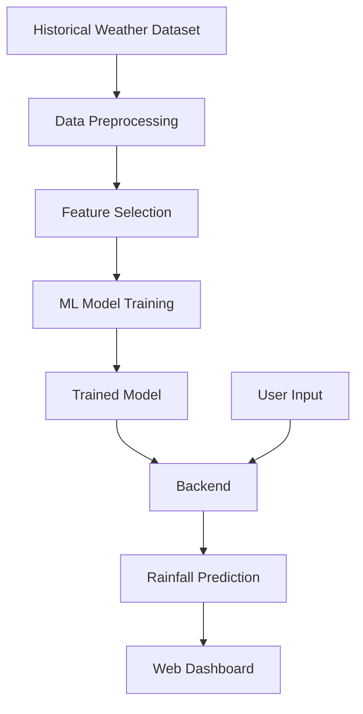

# 🌧️ Smart Rainfall Prediction System

A Machine Learning-based web application designed to predict rainfall using weather-related data and a trained ML model.

🌐 **Live Demo:** [Smart Rainfall Prediction System](https://rainfall-prediction-pzwd.onrender.com/)

## 📌 Project Overview

The Smart Rainfall Prediction System uses Machine Learning techniques to analyze weather-related features and predict rainfall. The project combines a trained model with a web-based dashboard to make rainfall prediction accessible and easy to understand.

**This project does not require an external weather API.** Predictions are generated using the input features and the trained Machine Learning model.

## 🎯 Objectives

- Develop a rainfall prediction system using Machine Learning.
- Analyze weather-related data for rainfall prediction.
- Train and use a suitable ML model.
- Create a simple and interactive web dashboard.
- Demonstrate the practical application of AI and Machine Learning in weather forecasting.

## ✨ Key Features

- Machine Learning-based rainfall prediction
- Weather dataset processing
- Data preprocessing and feature selection
- Trained model integration
- Interactive web dashboard
- Online deployment using Render
- No external weather API required

## 🛠️ Technology Stack

| Technology | Purpose |
|---|---|
| Python | Model development and backend logic |
| Pandas | Data handling and preprocessing |
| NumPy | Numerical operations |
| Scikit-learn | Machine Learning |
| Joblib | Saving and loading the trained model |
| FastAPI | Backend API framework |
| HTML | Webpage structure |
| CSS | Dashboard styling |
| JavaScript | Frontend interactions |
| Render | Online deployment |
| GitHub | Source code hosting |

## 🧠 How It Works

1. **Dataset Collection:** Weather-related historical data is used to develop the model.
2. **Data Preprocessing:** The data is cleaned and prepared for training.
3. **Model Training:** A suitable Machine Learning algorithm learns patterns from the dataset.
4. **Model Saving:** The trained model is saved for future predictions.
5. **User Input:** The dashboard collects or processes the required prediction features.
6. **Rainfall Prediction:** The trained model generates a prediction.
7. **Result Display:** The dashboard presents the prediction to the user.

## 🏗️ System Architecture



## 📁 Project Structure

```text
Rainfall-Prediction/
│
├── backend/
│   ├── main.py
│   └── test_pipeline.py
│
├── data/
│
├── frontend/
│   ├── index.html
│   ├── style.css
│   └── script.js
│
├── model/
│   ├── feature_config.joblib
│   └── rainfall_model.joblib
│
├── notebooks/
├── reports/
├── README.md
├── requirements.txt
└── requirements-notebooks.txt
```

## 🚀 Live Demo

Visit the deployed application:

**[Open Smart Rainfall Prediction System](https://rainfall-prediction-pzwd.onrender.com/)**

## 💻 Run the Project Locally

### Prerequisites

- Python
- Visual Studio Code (recommended)
- Required project dependencies

### Step 1: Clone the Repository

```bash
git clone https://github.com/manjot15058-ux/Rainfall-Prediction.git
cd Rainfall-Prediction
```

### Step 2: Create a Virtual Environment

```bash
python -m venv .venv
```

Activate it on Windows PowerShell:

```powershell
.\.venv\Scripts\Activate.ps1
```

### Step 3: Install Dependencies

```bash
python -m pip install -r requirements.txt
```

### Step 4: Run the Backend

```bash
uvicorn backend.main:app --reload
```

### Step 5: Open the Application

Open the backend API documentation:

[http://127.0.0.1:8000/docs](http://127.0.0.1:8000/docs)

If the backend serves the dashboard, open:

[http://127.0.0.1:8000/](http://127.0.0.1:8000/)

## 🌍 Applications

- Agricultural planning and rainfall awareness
- Weather data analysis
- Educational Machine Learning projects
- Demonstration of predictive analytics
- AI-based environmental applications

*Predictions depend on the quality of the dataset and model. This project should not be used as a substitute for official weather forecasts or emergency alerts.*

## 🔮 Future Scope

- Improve prediction accuracy through model experimentation.
- Add historical rainfall visualizations.
- Support additional weather features.
- Improve the dashboard's responsiveness.
- Compare multiple Machine Learning algorithms.
- Generate detailed prediction reports.

## 👩‍💻 Project Team

Developed by:

- Manjot Kaur
- Bavneet Kaur
- Ritika

**Programme:** B.Tech – Artificial Intelligence and Data Science  
**Institution:** CT University

## 🎓 Conclusion

The Smart Rainfall Prediction System demonstrates how Machine Learning can be used to analyze historical weather data and predict rainfall without relying on an external weather API. It integrates a trained model, backend processing, and a web dashboard into one application.

---

**🌧️ Smart Rainfall Prediction System**  
*Predicting rainfall through Machine Learning.*
