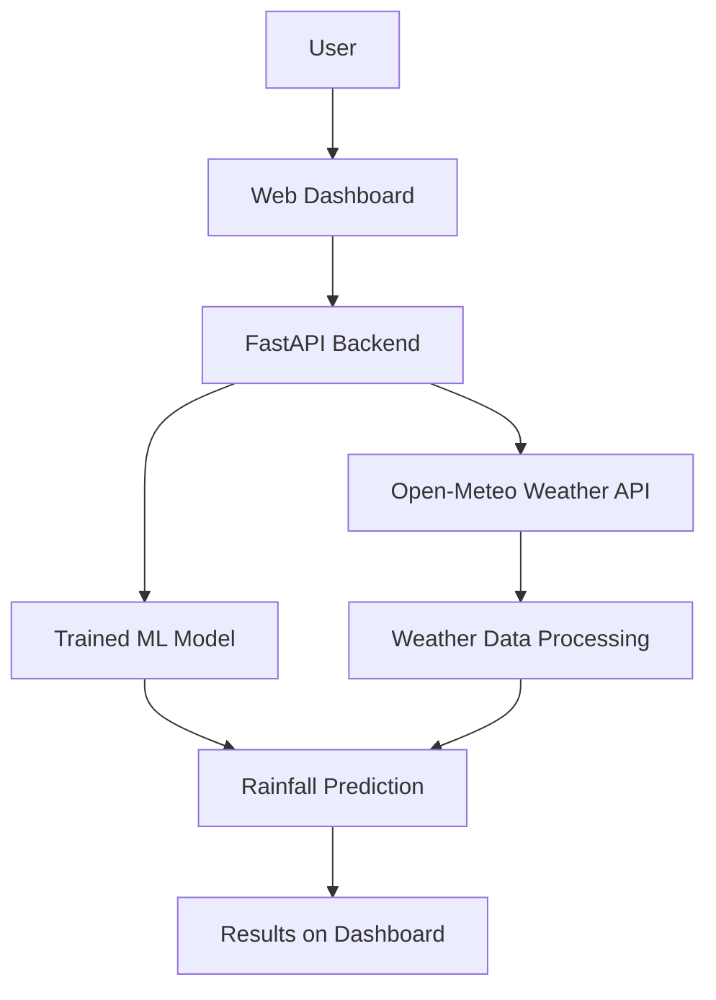

# 🌧️ Smart Rainfall Prediction System

An intelligent weather forecasting web application that combines Machine Learning with weather data to help users understand upcoming rainfall conditions.

<p align="center">

**🌐 Live Demo:** [Smart Rainfall Prediction System](https://rainfall-prediction-pzwd.onrender.com/)

</p>

## 📌 Project Overview

The **Smart Rainfall Prediction System** is a web-based project designed to provide rainfall-related forecasts using weather information and a trained Machine Learning model.

The application uses a web interface to present weather information in an accessible format. It aims to demonstrate how Machine Learning, weather APIs, and web development can work together to support weather awareness and planning.

## 🎯 Objectives

- Develop a user-friendly rainfall prediction web application.
- Integrate weather data with a Machine Learning model.
- Process weather information to generate rainfall-related predictions.
- Display weather information through an interactive dashboard.
- Explore the use of AI and Machine Learning in weather forecasting.

## ✨ Key Features

- **Weather Forecasting:** Access weather information for forecasting purposes.
- **Machine Learning Integration:** Uses a trained model for rainfall-related prediction.
- **Interactive Dashboard:** Presents information through a web-based interface.
- **Weather Data Integration:** Connects with the Open-Meteo weather service.
- **Web-Based Access:** The deployed application can be accessed through a browser.
- **Modular Structure:** Separates the frontend, backend, model files, and supporting resources.

## 🛠️ Technology Stack

| Technology | Purpose |
|---|---|
| Python | Backend development and ML integration |
| FastAPI | Backend API framework |
| HTML | Webpage structure |
| CSS | Dashboard styling |
| JavaScript | Frontend interactions |
| Scikit-learn | Machine Learning tools |
| Joblib | Saving and loading model files |
| Open-Meteo API | Weather data integration |
| Render | Application deployment |
| Git & GitHub | Version control and project hosting |

## 🏗️ System Architecture

The system follows a modular architecture:

1. **Weather Data:** Weather information is retrieved from the weather data service.
2. **Backend Processing:** The Python backend processes requests and manages application logic.
3. **Machine Learning Model:** The saved model is used for prediction where required by the application.
4. **Frontend Dashboard:** HTML, CSS, and JavaScript present the available information to the user.
5. **Deployment:** Render hosts the web application for online access.



## 📁 Project Structure

```text
Rainfall-Prediction/
│
├── backend/
│   ├── main.py
│   └── test_pipeline.py
│
├── data/
│
├── frontend/
│   ├── index.html
│   ├── style.css
│   └── script.js
│
├── model/
│   ├── feature_config.joblib
│   └── rainfall_model.joblib
│
├── notebooks/
├── reports/
├── README.md
├── requirements.txt
└── requirements-notebooks.txt
```

## 🚀 Live Application

Try the deployed application here:

**[Open Smart Rainfall Prediction System](https://rainfall-prediction-pzwd.onrender.com/)**

The application is hosted on Render and can be opened in a compatible web browser. Availability may depend on the hosting service.

## 💻 Run the Project Locally

### Prerequisites

Install the following before starting:

- Python 3.10 or another version compatible with the project dependencies
- Visual Studio Code (recommended)
- Git (optional, for cloning the repository)

### Step 1: Clone the Repository

```bash
git clone https://github.com/manjot15058-ux/Rainfall-Prediction.git
cd Rainfall-Prediction
```

If your repository contains an additional inner `Rainfall-Prediction` folder, open the folder that contains `backend`, `frontend`, `model`, and `requirements.txt`.

### Step 2: Create a Virtual Environment

```bash
python -m venv .venv
```

Activate it on Windows PowerShell:

```powershell
.\.venv\Scripts\Activate.ps1
```

### Step 3: Install Dependencies

```bash
python -m pip install -r requirements.txt
```

### Step 4: Start the Backend

```bash
uvicorn backend.main:app --reload
```

### Step 5: Open the Application

Open the API documentation to check whether the backend is running:

[http://127.0.0.1:8000/docs](http://127.0.0.1:8000/docs)

If your backend serves the frontend dashboard, open:

[http://127.0.0.1:8000/](http://127.0.0.1:8000/)

Keep the backend terminal running while using the local application.

## 🌍 Applications

- Agricultural planning and weather awareness
- Everyday outdoor activity planning
- Educational demonstrations of Machine Learning
- Weather data analysis
- Academic projects involving AI and web development

*This project is an educational forecasting application and should not replace official weather warnings or emergency guidance.*

## 🔮 Future Scope

- Improve model performance through further training and evaluation.
- Add historical weather visualizations.
- Expand forecast information and location support.
- Improve mobile responsiveness and accessibility.
- Add more detailed prediction reports.
- Integrate additional verified weather data sources.

## 👩‍💻 Project Team

Developed as an academic project by:

- **Manjot Kaur**
- **Bavneet Kaur**
- **Ritika**

**Programme:** B.Tech – Artificial Intelligence and Data Science  
**Institution:** CT University

## 🎓 Project Outcome

This project demonstrates the integration of a Python backend, weather data services, a Machine Learning model, and a web dashboard into a single application. It provides practical experience in AI/ML integration, API development, frontend development, and cloud deployment.

## 🤝 Contributions

Suggestions and improvements are welcome. You can fork the repository, create a separate branch, and submit a pull request with your proposed changes.

## 📄 License

No license has been specified yet. Add an appropriate open-source license if you intend to permit others to reuse or modify the project.

---

<p align="center">

**🌧️ Smart Rainfall Prediction System**  
*Using Machine Learning and Weather Data for Smarter Forecasting.*

</p>
